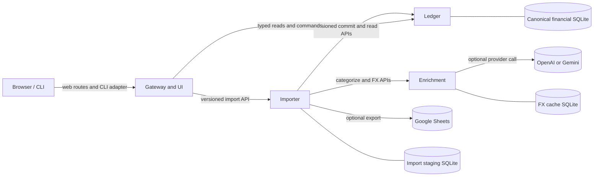

# Local service architecture

Spectra is a local-first application made of four independent Python/FastAPI processes. The
repository is a monorepo and the current Compose deployment builds one image, but each process
has its own ASGI entrypoint, HTTP contract, runtime role, and data ownership. A process never
opens another service's SQLite store.

## Process ownership

| Process | Entrypoint | Responsibilities | Persistent state it owns |
|---|---|---|---|
| Gateway/UI | `spectra.web.server:app` | Jinja pages, web-facing routes, input validation, typed clients, readiness/errors | None |
| Importer | `spectra.services.importer.app:app` | Bounded parsing and orchestration, review drafts, confirmation, CLI import path, optional Sheets adapter | `IMPORT_DB_PATH`: seven-day review staging |
| Ledger | `spectra.services.ledger.app:app` | Financial read models, account/transaction operations, currency migration, atomic/idempotent commit, backup download | `DB_PATH`, default `data/spectra.db` |
| Enrichment | `spectra.services.enrichment.app:app` | Local/cloud categorization and fail-closed FX conversion | `FX_DB_PATH`: regenerable rate cache |

Only ledger reads or migrates the canonical store. Its `prism.db` → `spectra.db` compatibility
migration runs from the ledger role; loading settings in gateway, importer, or enrichment does
not open, move, copy, or create the financial DB. The gateway knows domain API names/read-model
names, not SQLite tables or columns, and has no SQL transport. `/internal/v1/ledger/operations`
is a temporary compatibility adapter with an explicit allowlist of ledger domain methods; it
accepts method arguments, never SQL or table identifiers. Named read models remain ledger-owned.

The importer and enrichment stores are disposable service state, not replicas of the financial
ledger. Import jobs expire after seven days; if staging is lost, an uncommitted statement must be
uploaded again. FX rates can be fetched again when connectivity permits. Backups cover only the
canonical ledger and do not claim a consistent snapshot across staging/cache stores. A committed
import is durable in ledger before optional Sheets export; retries use the same idempotency key.

## Import and commit flow

1. The browser sends the upload to the gateway; the gateway relays it to the importer.
2. The importer applies the upload limit, parses in a worker, reads existing ledger data through
   the versioned API, requests categorization/FX from enrichment, and stores a review draft in its
   own SQLite staging file.
3. The browser receives the staged `job_id` and editable suggestions. No financial rows are
   committed yet.
4. Confirmation returns to the importer. It merges reviewed fields with immutable source fields,
   then asks the ledger to atomically store transactions, dedup markers, account/transfer updates,
   and learning feedback.
5. Ledger idempotency receipts make retries safe after a timeout. Optional Sheets export runs
   only after the canonical local commit and can be retried separately.

The CLI uses the same importer and ledger HTTP contracts. Start the stack with `uv run spectra
--serve` before using `uv run spectra --file ...`; `--dry-run` prepares a preview without a ledger
commit. A successful non-dry-run CLI import uses a stable file/content key so repeating the same
statement does not duplicate records.

## Contracts and health

All internal HTTP endpoints use the `/internal/v1/` namespace and JSON/Pydantic request models in
`src/spectra/services/contracts.py`. HTTP adapters live in `clients.py`; process entrypoints and
implementation are separated by `services/{ledger,importer,enrichment}/app.py`. Readiness checks
dependencies and SQLite integrity where relevant. The gateway returns HTTP 503 with dependency
status when an internal process is unavailable; `/health/live` remains process-local.

## Local deployment

`docker compose up -d --build` starts all four containers on one private Compose network. Only
gateway maps a host port, default `127.0.0.1:8080`; the other ports are not published. The
canonical DB volume is mounted only into ledger, staging only into importer, and FX cache only
into enrichment. Optional AI credentials are passed only to enrichment and Sheets credentials
only to importer. `./spectra start --build` is the supported Docker convenience launcher.

For native use, install with `uv sync --locked`, then run `uv run spectra --serve`. This spawns
the same four separate processes bound to loopback and manages their shutdown together. Internal
ports default to 8081–8083 and can be set with `SPECTRA_LEDGER_PORT`, `SPECTRA_IMPORTER_PORT`,
and `SPECTRA_ENRICHMENT_PORT`. The browser-facing gateway defaults to `127.0.0.1:8080`; use
`--host` only when intentionally exposing the unauthenticated UI to a trusted network.

For financial backup, use `uv run spectra --backup-db /path/to/new-backup.sqlite` while services
are running. The ledger takes a SQLite online snapshot, and the local CLI validates and streams
it to a new file. Restore is an offline one-shot ledger maintenance operation: stop every
service, preserve the current database and its sidecars, and restore only to an absent target.
Import staging and FX cache are not part of that backup.
